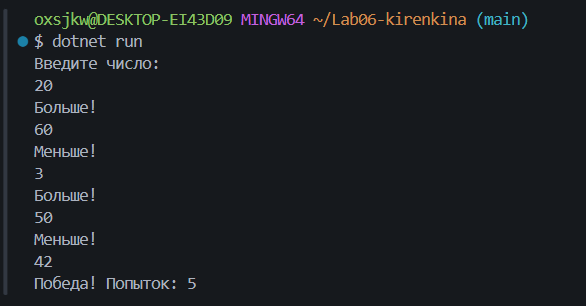

# Практическая работа №6
**ФИО:** Киренкина Вероника
**Группа:** ИСП-241
**Дата:** 19.11.2026
## Что изучено
- Циклы for, while, do while
- Отличие while от do while (в do while условие проверяется в конце и нужна \;)
- Научилась выбирать цикл подходящий под задачу

## Результат

у меня нет скрина после git push, потому что я его сделала в волгу и убежала домой!! :(